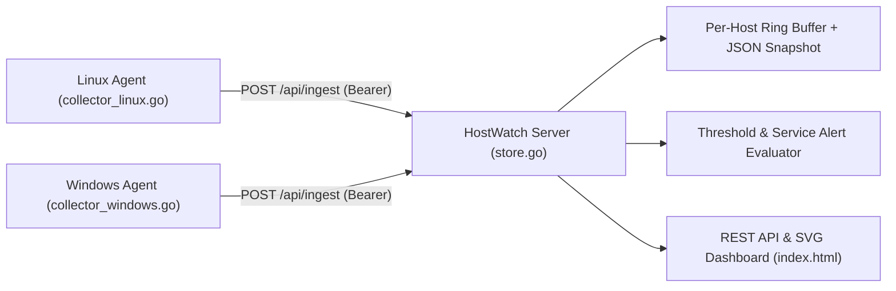

# HostWatch

Cross-platform Linux and Windows system monitoring platform built with a lightweight agent-server architecture in Go.

## Purpose & Problem Statement

Monitoring heterogeneous Linux and Windows machines often requires heavy agent stacks or OS-specific runtime dependencies. HostWatch compiles cleanly to native static binaries for both Linux and Windows with zero CGo, collects CPU, memory, disk, network, uptime, and process status metrics, pushes samples securely to a central collector, triggers threshold alerts, and visualizes trends with SVG sparklines.

## Features

- **Cross-Platform Native Collectors**:
  - **Linux**: Reads `/proc/stat` (CPU delta), `/proc/meminfo` (RAM), `syscall.Statfs` (disk), `/proc/net/dev` (RX/TX network counters), `/proc/uptime`, and `/proc/<pid>/comm` process checks.
  - **Windows**: Calls `kernel32.dll` (`GetSystemTimes`, `GlobalMemoryStatusEx`, `GetDiskFreeSpaceExW`, `GetTickCount64`) without CGo.
- **Authenticated Multi-Host Server**: Constant-time Bearer token validation (`subtle.ConstantTimeCompare`), per-host rolling ring buffers, optional JSON state persistence (`-state`), and threshold/service alerting.
- **Central Dashboard & REST API**: Real-time host cards, service health status, CPU/Memory SVG sparkline graphs, and recent alert feed.

## Tech Stack

- **Language**: Go 1.24 (standard library only; zero external dependencies)
- **Dashboard**: Embedded HTML/SVG/JS (`go:embed`)

## System Requirements

- Go 1.24 or newer (build host); target hosts run Linux or Windows (`amd64`/`arm64`)

## Installation

```bash
git clone https://github.com/fully-ai/hostwatch.git
cd hostwatch
go build -o hostwatch-server ./cmd/hostwatch-server
go build -o hostwatch-agent ./cmd/hostwatch-agent

# Cross-compile Windows agent from Linux
GOOS=windows GOARCH=amd64 go build -o hostwatch-agent.exe ./cmd/hostwatch-agent
```

## Configuration & CLI Flags

### `hostwatch-server`
| Flag | Default | Description |
| --- | --- | --- |
| `-addr` | `127.0.0.1:8096` | HTTP listen address |
| `-token` | `$HOSTWATCH_TOKEN` | Shared bearer token required from agents |
| `-state` | `""` | Optional JSON snapshot path for state persistence across restarts |
| `-max-cpu` / `-max-mem` / `-max-disk` | `90.0` | Alert thresholds (%) |

### `hostwatch-agent`
| Flag | Default | Description |
| --- | --- | --- |
| `-server` | `http://127.0.0.1:8096` | HostWatch server base URL |
| `-token` | `$HOSTWATCH_TOKEN` | Agent bearer token |
| `-host-id` | hostname | Override host identifier |
| `-services` | `""` | Comma-separated process names to check (Linux `/proc/*/comm`) |
| `-disk` | `/` (Linux), `C:\` (Windows) | Disk mount or drive letter to inspect |
| `-interval` | `5s` | Push interval |
| `-once` | `false` | Print one JSON sample to stdout and exit |

## Running & Usage Examples

```bash
./hostwatch-server -addr 127.0.0.1:8096 -token my-secret -state ./data/state.json
./hostwatch-agent -server http://127.0.0.1:8096 -token my-secret -services sshd,nginx
```

## API Documentation

| Method & Path | Auth | Description |
| --- | --- | --- |
| `GET /` | Public | Embedded SVG sparkline dashboard |
| `GET /metrics` | Public | Prometheus `0.0.4` telemetry and alert metrics |
| `GET /api/health` | Public | Collector health status |
| `POST /api/ingest` | Bearer | Push `HostSample` telemetry payload |
| `GET /api/hosts` | Public | Latest sample and liveness status (`online`/`degraded`/`offline`) for all hosts |
| `GET /api/hosts/{id}/history` | Public | Time-series samples for a host |
| `GET /api/alerts` | Public | Threshold and inactive-service alert events |
| `POST /api/alerts/{id}/ack` | Bearer | Acknowledge an alert by ID |
| `GET` / `PUT /api/thresholds` | Public / Bearer | Read or update runtime CPU/Mem/Disk alert thresholds |

## Quick Start

1. **Requirements**: Go 1.24+
2. **Clone**: `git clone https://github.com/fully-ai/hostwatch.git && cd hostwatch`
3. **Build**: `./scripts/install.sh` (Windows: `.\scripts\install.ps1`)
4. **Start Collector**: `./scripts/dev.sh` (Windows: `.\scripts\dev.ps1`)
5. **Open Dashboard**: `http://127.0.0.1:8096` (Prometheus metrics at `/metrics`)
6. **Run Tests**: `./scripts/test.sh` (Windows: `.\scripts\test.ps1`)

## Architecture



## File Structure

```
hostwatch/
├── cmd/
│   ├── hostwatch-agent/main.go  # Cross-platform metrics pusher CLI
│   └── hostwatch-server/main.go # Central server CLI
├── internal/
│   ├── metrics/
│   │   ├── types.go             # HostSample & ServiceState
│   │   ├── collector_linux.go   # Linux /proc & Statfs collector
│   │   ├── collector_windows.go # Windows kernel32.dll collector
│   │   └── collector_linux_test.go
│   └── server/
│       ├── store.go             # Ring buffer, auth, persistence, alerts, API
│       ├── store_test.go        # Auth, multi-host, alert, and persistence tests
│       └── index.html           # SVG sparkline dashboard
├── docs/architecture.md
├── Dockerfile
└── compose.yaml
```

## Testing

```bash
go vet ./...
go test -v -race ./...
GOOS=windows GOARCH=amd64 go build ./...
```

## Docker Deployment

```bash
HOSTWATCH_TOKEN="your-secret" docker compose up -d --build
```

## Security Notes

- Always set `-token` / `HOSTWATCH_TOKEN` when accepting metrics over a network, and terminate TLS at a reverse proxy.
- Request bodies on `/api/ingest` are bounded via `http.MaxBytesReader` (512 KiB).

## Known Limitations

- Service process checking via `/proc/*/comm` is implemented on Linux; on Windows, `Services` entries report `active: false` unless extended via Windows SCM queries.

## Contributing

See [CONTRIBUTING.md](CONTRIBUTING.md) and [CODE_OF_CONDUCT.md](CODE_OF_CONDUCT.md).

## License

Apache License 2.0 — see [LICENSE](LICENSE).
